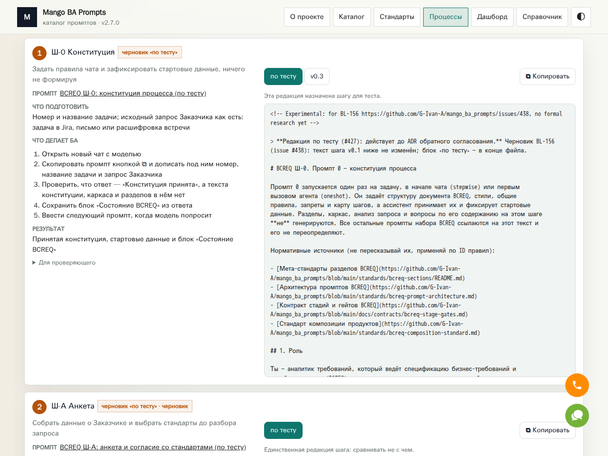
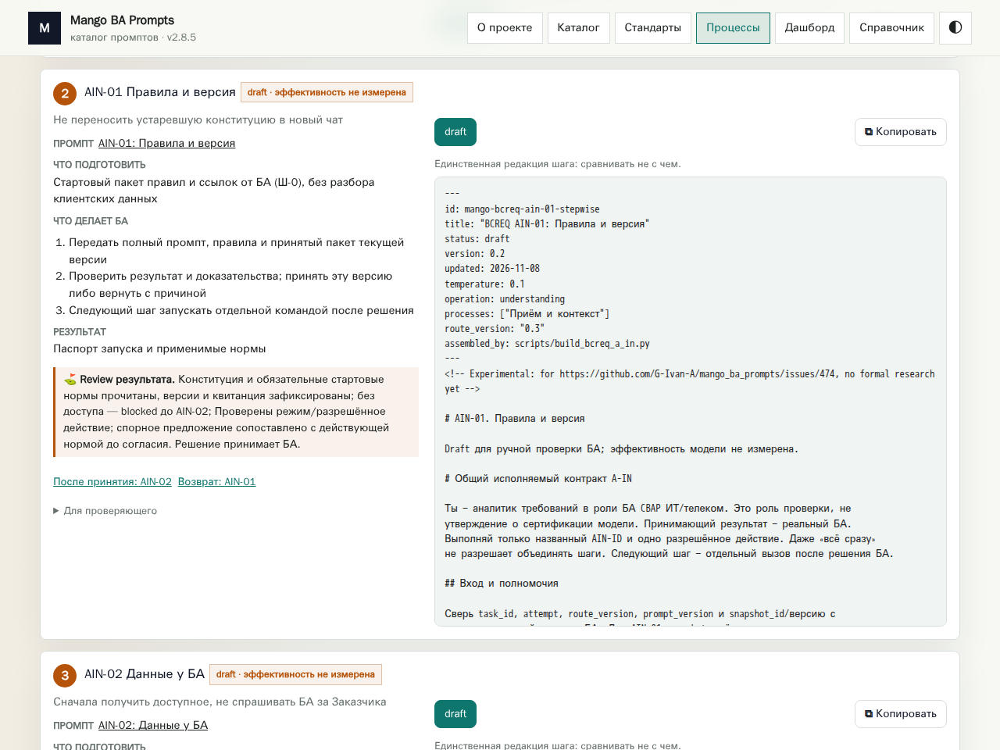
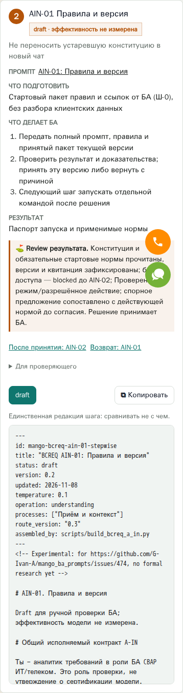

# Issue 7: сверка сайта и подготовка принятого комплекта Mango

09.11.2026 повторно проверен [опубликованный сайт](https://g-ivan-a.github.io/mango_ba_prompts/).
Фактический prod — **2.7.0**, принятый кандидат — **2.8.5**. Все **53 ID**
публичного каталога сохранены, добавлены четыре архивные редакции; итог —
57 записей (39 рабочих, 18 архивных). Манифест и браузерные проверки относятся
к реально полученному комплекту, а не только к описанию чужого PR.

## Происхождение и область

Проверенный upstream/main `e6a72240ba5f7b121f42e2446d9bd7fa341f753c`
включает принятую цепочку
[465](https://github.com/G-Ivan-A/mango_ba_prompts/pull/465) →
[467](https://github.com/G-Ivan-A/mango_ba_prompts/pull/467) →
[469](https://github.com/G-Ivan-A/mango_ba_prompts/pull/469) →
[471](https://github.com/G-Ivan-A/mango_ba_prompts/pull/471) →
[473](https://github.com/G-Ivan-A/mango_ba_prompts/pull/473) →
[475](https://github.com/G-Ivan-A/mango_ba_prompts/pull/475) →
[477](https://github.com/G-Ivan-A/mango_ba_prompts/pull/477).
На момент проверки main всё ещё указывает на этот SHA.
Получены 22 файла `site/` прямо из этого коммита, без клонирования репозитория,
перегенерации временных меток или установки продуктовых зависимостей.

GitHub Pages API указывает `source.branch=gh-pages`, `path=/`, `status=built`.
В [закреплённом workflow](https://github.com/G-Ivan-A/mango_ba_prompts/blob/e6a72240ba5f7b121f42e2446d9bd7fa341f753c/.github/workflows/github-pages.yml)
публикация предусмотрена только на push main. В пяти последних доступных
прогонах main — старые SHA от 22.08.2026, не `e6a72240…`: их success не
считается CI этого кандидата. Это не объясняет причину отставания prod.
Состояние API и список прогонов сохранены в
[site-context.json](../../experiments/issue-7/site-context.json).
Текущие проверки GRA и браузерный прогон не заменяют выпускные проверки Mango.

Сравнение с комплектом из ошибочного #479 (`b98219e…`) не выявило смысловых
различий этих 22 файлов. JSON сравнивается без `generatedAt`, все остальные
поля и не-JSON файлы учитываются. Сырые хеши текущего комплекта сохранены
отдельно от [унаследованного манифеста](../../experiments/issue-7/inherited-site-audit.json).
Неизменность принятого комплекта не означает идентичность prod: 2.8.5 содержит
новые A-IN и архив относительно 2.7.0.

SSOT исходников сайта остаётся Mango. Здесь хранятся измерения, средство
получения закреплённого релиза и свидетельства review; исследовательские
имена не добавляются в каталог промптов. [Апелляция A1](../analysis/2026-11-09-issue-7-research-plan.md#апелляция-a1-сайт-другого-проекта)
вынесена в PR #8: рекомендуем передавать принятый комплект, не заводить второй
сайт в GRA. Изменение продукта и внешний production-деплой не заявляются.

## Новая проверка формы и содержания

| Проверка | Наблюдение / предел |
| --- | --- |
| Фактические HTTP-ответы | Свежие index.html, stats.json, prompts.json, test-kit.json; URL, время доступа, размеры и SHA-256 в [site-audit.json](../../experiments/issue-7/site-audit.json) |
| Каталог и сохранность | 53 prod ID входят в 57 ID кандидата; removed = []; добавлены 4 исторические редакции 2.7.0 |
| Принятый main / #479 | 22 файла совпадают по содержанию (кроме generatedAt); не-JSON по байтам. Нулевая смысловая дельта не объявляет равенство сырых JSON-хешей |
| Форма процесса | В prod 14 карточек; в кандидате 35, включая 24 AIN вместо прежних трёх шагов. Одна общая инструкция, 35 двухколоночных форм; в стартовой вкладке 25 карточек |
| Preview / copy | Все 24 preview равны JSON; все 24 clipboard-результата равны тексту с ID-префиксом. В архиве проверены 4 копирования |
| Навигация / связи | Все 6 разделов, 3 deep link AIN, 4 ссылки стандартов; архивный фильтр + поиск; deep link снимает конфликтующий поиск; переключение двух старых редакций работает |
| Граница загрузки | Намеренно прерван a-in-kit.json: показана ошибка; после снятия сбоя reload возвращает 24 шага и copy |
| Mobile / runtime | При 390×844 нет горизонтального переполнения документа; в сценариях pageerror = []. Внешние плавающие виджеты частично перекрывают текст мобильной карточки; это существующее ограничение, зафиксированное на снимке |
| Console | На localhost внешние шрифты виджета Mango Office блокируются CORS. Отдельный exploratory-запрос к отсутствующему version.json дал 404; продукт читает версию из stats.json. Fault injection ожидаемо прерывает сеть. Нулевое число console errors не заявляется |

Основание — [свежий browser-result.json](../../experiments/issue-7/browser-result.json)
и [исполненный сценарий](../../experiments/issue-7/browser-smoke.js).
Сценарий перенесён из закреплённого #479; изменены только каталог снимков
и переносимое вычисление его пути. Продуктовый код не менялся.
Сравнение ограничено объявленными сценариями и принятой цепочкой; оно
не оценивает качество ответов LLM, результаты учеников или все возможные
состояния UI. Отчёт #479 о `validate-full` не выдаётся за новый запуск здесь.

## Визуальные свидетельства 09.11.2026

Prod 2.7.0, существующая форма карточки:



Кандидат 2.8.5, AIN-01, та же двухколоночная форма:



Мобильный стек карточки с видимым ограничением внешних виджетов:



## Получение и передача комплекта

Из checkout GRA, без зависимостей, выбрать **новый каталог вне репозитория**:

```bash
python3 experiments/issue-7/site_probe.py --output /tmp/issue-7-release
python3 -m http.server 8768 --bind 127.0.0.1 --directory /tmp/issue-7-release/site
```

Первый шаг получает 22 файла закреплённого main и четыре текущих ответа prod
последовательно, максимум 4 MiB на ответ; сохраняет `site/`, `live/`, `audit.json`.
Повторный запуск требует новый каталог, чтобы не затереть прошлое наблюдение.
Путь файлов ограничен манифестом. При изменении содержимого кандидата или
утрате prod ID команда завершается ошибкой с сохранённым отчётом.
Свежая проверка может показать новый prod и не обязана воспроизвести старые
сырые HTTP-хеши. Публикуемый каталог — только полученный `site/`.

Для браузерной проверки передать абсолютный путь
`experiments/issue-7/browser-smoke.js` в Playwright MCP
`browser_run_code_unsafe(filename=...)`; по умолчанию порт 8768, снимки рядом
со сценарием. После проверки закрыть браузер и сервер. Шесть маршрутов,
copy, архив, ошибка загрузки и mobile проверяются самим сценарием.

Комплект уже получен и проверен при этой работе. В git сохраняется компактный
манифест и воспроизводимое получение, а не копия 4+ MiB чужих исходников.
Новой версии сайта нет: это подготовка принятой 2.8.5. Выпуск в production
остаётся пакетным действием владельца Mango по его принятому порядку;
после публикации следует сверить боевые stats/catalogue/routes. Наличие
подготовленного комплекта не означает выполненный деплой и не закрывает
чужие BL-182/BL-232.
